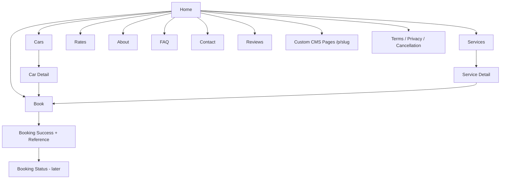
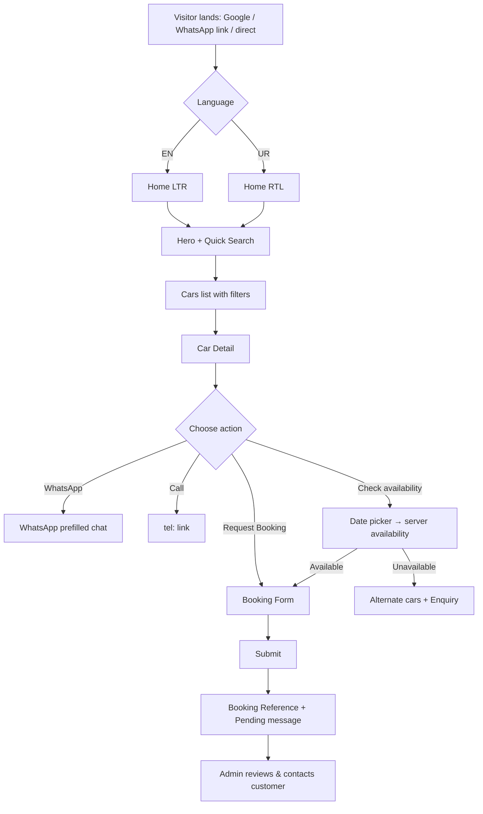
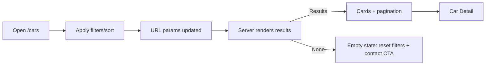
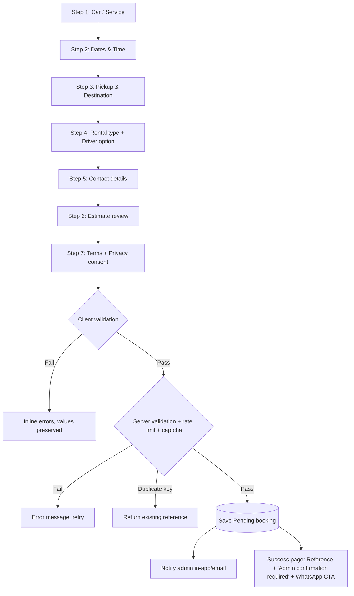
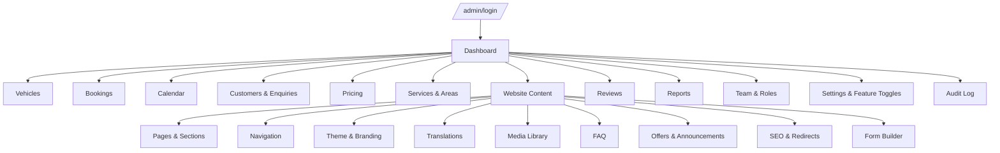
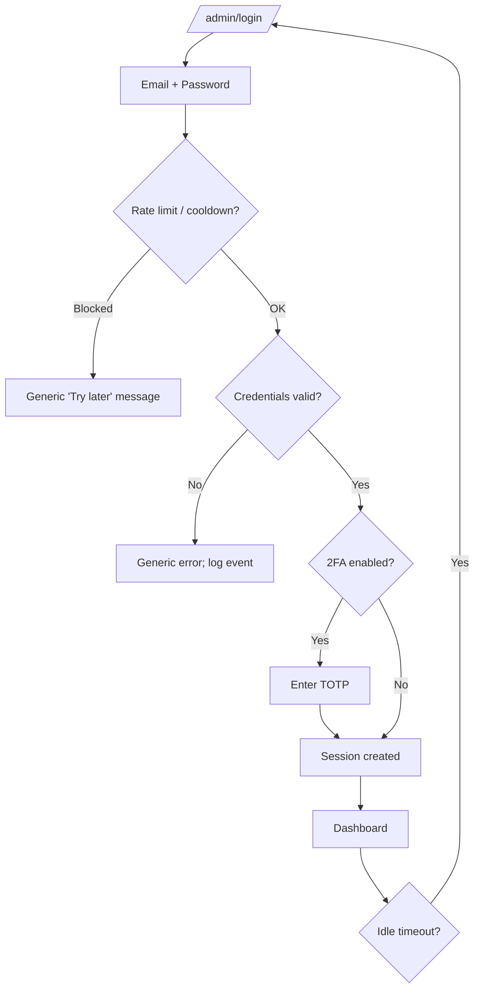
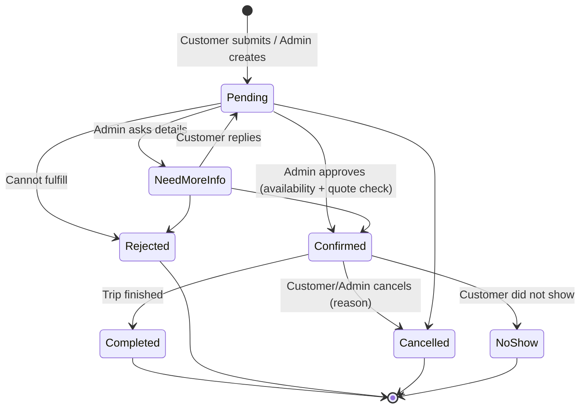
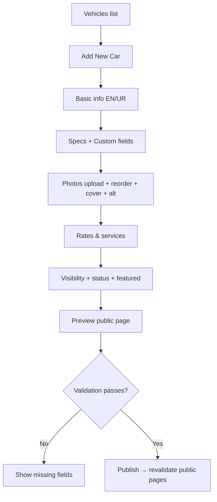
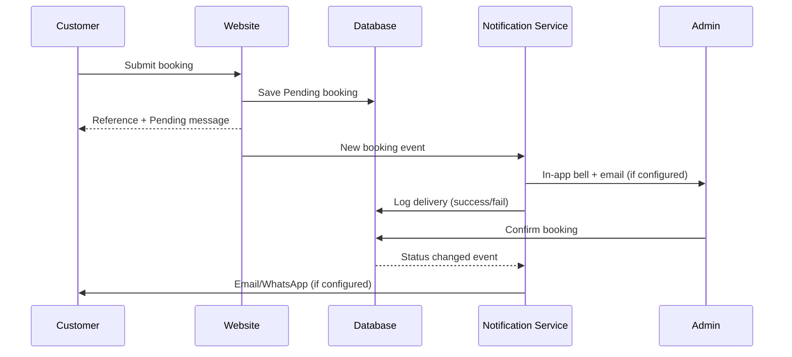

# Rent2Go — App Flow (User & Admin Experience)

**Version:** 1.0 | **Related:** `01_PRD_Rent2Go.md`, `04_UI_UX_Design_Brief.md`

Diagrams Mermaid format mein hain (GitHub, VS Code, Notion mein render hote hain).

---

# PART A — CUSTOMER (PUBLIC) EXPERIENCE

## A1. Site Map


## A2. Primary Journey — Browse → Book


## A3. Home Page Flow
1. Announcement bar (agar admin ne on kiya) → 2. Header → 3. Hero (headline, CTAs) → 4. Quick search → 5. Featured cars → 6. Services → 7. Why Rent2Go → 8. How it works → 9. Reviews → 10. FAQs → 11. Service areas → 12. Final CTA → 13. Footer + floating WhatsApp.
*(Sections ka order/visibility admin ke CMS se control hota hai.)*

**Edge cases**
- Koi featured car nahi → section auto-hide.
- Koi approved review nahi → reviews section hide.
- Phone/WhatsApp unset → related buttons hide.

## A4. Cars Listing Flow

- Filter chips remove individually / Clear all.
- Shared URL same results deta hai.
- Sirf `Published` + non-maintenance cars.

## A5. Car Detail Flow
- Gallery (lightbox, swipe) → Specs → Custom fields → Rates & inclusions → Availability checker → Similar cars → CTA bar (sticky on mobile).
- **Availability check:** user dates select → server query → `Available` / `Not available` / `Confirm availability` (agar calendar reliable na ho).
- Unavailable → alternate cars + "Send enquiry".

## A6. Booking Request Flow (Detailed)

**Validations:** future pickup (Asia/Karachi), return > pickup, PK phone normalize (+92), passengers ≤ capacity, notes length limit, consent required.
**States:** loading (submit disabled + spinner), success, error (retry), network failure (data preserved).
**Estimate display:** breakdown + label "Estimated — subject to confirmation"; rate missing → "Contact for quote".

## A7. Booking Status Lookup (Later Phase)
Reference + phone → OTP verify → status timeline (Pending / Need More Info / Confirmed / etc.). Bina verification koi data nahi dikhta.

## A8. WhatsApp Flow
Button click → URL-encoded prefilled message (car, dates, from/to, ref) → WhatsApp app/web. (Button booking confirm nahi karta.) Number missing → button hidden.

## A9. Contact / Enquiry Flow
Contact page → form (name, phone, message, optional service) → validate → save enquiry (source: website) → admin inbox notification → success message.

## A10. Language Switch Flow
Switch → same page ka translated version (agar exist) → `dir` + layout flip → preference saved. Translation missing → English fallback.

## A11. Error Pages
- 404: helpful links (Home, Cars, Contact).
- 500/network: retry guidance, contact options.
- Maintenance mode (admin toggle): friendly page + WhatsApp.

---

# PART B — ADMIN EXPERIENCE

## B1. Admin Map


## B2. Login & Session Flow

Forgot password → email link → set new password → all sessions invalidated.
Unauthorized module access → "No permission" page (aur audit log mein attempt).

## B3. Dashboard Flow
Cards (pending, upcoming, today pickups/returns, maintenance, enquiries pending) → click-through to filtered lists. Alerts: notification channel failing, missing settings (phone/WhatsApp/hours not set), missing Urdu translations. "Setup checklist" card jab tak launch info incomplete ho.

## B4. Booking Handling Flow

**Step-by-step (Admin)**
1. New booking notification (bell/email) → open Bookings (filter: Pending).
2. Detail view: trip info, customer, estimate, notes, history.
3. Check **calendar conflict** (auto warning).
4. Contact customer (call/WhatsApp button with prefilled message).
5. Set **final quote** (preview calculator), deposit, notes.
6. Click **Confirm** → server transaction + conflict check:
   - Success → status Confirmed, quote snapshot, history entry, optional customer notification.
   - Conflict → error + suggestion (alternate car / change dates).
7. Later: Complete / Cancel (reason required) / No Show.
8. Payment status update (deposit received, paid, etc.).

**Manual booking:** Bookings → "New Booking" → customer (search/create) → car + dates → availability check → quote → save as Confirmed/Pending → source = phone/WhatsApp.

## B5. Vehicle Management Flow

Maintenance: Car → "Add maintenance window" → dates → calendar block (conflicting confirmed bookings par warning).
Hide/Deactivate → public site se foran remove, bookings history safe.

## B6. Calendar Flow
Views: Month / Week / Day / Vehicle timeline. Colour + icon: Pending (outlined), Confirmed (solid), Maintenance (hatched), Completed (muted). Click event → booking detail; click empty slot → "New booking / Add maintenance block". Filter by vehicle/status.

## B7. Pricing Flow
Pricing → Rate rules list → Add rule (scope: vehicle/service/route/duration; unit; amount; inclusions; effective dates) → **Fare Preview** (sample inputs → breakdown) → Save → rule active from effective date → history logged. Existing confirmed bookings unchanged.

## B8. Website Content Editing Flow (Advanced CMS)
```mermaid
flowchart TD
  A[Website Content] --> B[Choose Page e.g. Home]
  B --> C[Section list with drag-reorder / show-hide / duplicate]
  C --> D[Select section → edit panel EN | UR tabs]
  D --> E[Live preview: Desktop / Mobile / Urdu RTL]
  E --> F[Autosave Draft]
  F --> G{Ready?}
  G -->|Preview link| H[Share signed preview link]
  G -->|Schedule| I[Set publish date/time]
  G -->|Publish now| J[Validation]
  J -->|Errors| D
  J -->|OK| K[Create revision + revalidate public site]
  K --> L[Version history]
  L --> M[Compare / Rollback to any version]
```
**Sub-flows**
- **Add custom page:** Pages → New → title/slug/template → add sections → SEO → publish → optional add to menu.
- **Navigation:** Menus → Header/Footer → add item (page/URL) → drag reorder → nesting → show/hide → save.
- **Theme:** Theme → logo/favicon upload → colour pickers (contrast checker warns) → fonts → radius/buttons → live preview → publish.
- **Translations:** Translations → filter missing/Urdu → inline edit → save → publish.
- **Media:** Library → upload (drag-drop) → alt text EN/UR → folder → usage info → delete (warn if in use).
- **FAQ:** Add Q/A (EN/UR) → category → order → visibility.
- **Offers/Announcement:** Create → text → link → start/end date → placement → enable.
- **SEO:** Per page title/meta/OG/canonical/noindex; redirects (old → new, 301).
- **Form builder:** Booking/Contact form → toggle optional fields, required flag, labels (EN/UR), order; core fields locked (name, phone, pickup, date).
- **Feature toggles:** Settings → Modules → on/off (self-drive, hourly, airport, reviews, floating WhatsApp, payments tracking, announcement bar).

## B9. Customers / Enquiries Flow
Inbox (new enquiries) → open → reply via WhatsApp/call → add note + follow-up date → convert to booking (prefilled) → tag/source. Export (permission + logged).

## B10. Reviews Moderation Flow
New/imported review → Pending → Approve (publish) / Hide / Reject → optional admin reply. Manual add requires "verified source" note.

## B11. Reports Flow
Select date range → cards + charts (bookings by status, popular cars/services, conversion) → estimated vs confirmed vs received value (clearly separate) → CSV export (permission, minimal fields).

## B12. Team & Roles Flow (Owner)
Team → Invite user (email) → assign role → (optional) custom role → permission matrix → activate/deactivate → session management. Changes audit-logged.

## B13. Settings Flow
Business profile → contact → hours/holidays → booking rules → WhatsApp template → notification channels → analytics → maintenance mode → backup/export. **Setup warnings** jab critical settings empty hon.

## B14. Audit Log Flow
Filter by user/module/action/date → open entry → before/after view → export (permission).

---

# PART C — CROSS-CUTTING STATES

| State | Behaviour |
|---|---|
| Loading | Skeleton/spinner, buttons disabled |
| Empty | Helpful text + action button |
| Error | Plain message + retry; form values preserved |
| Success | Toast / confirmation page |
| Unsaved changes | Warn on leave; autosave drafts |
| No permission | 403 page, action logged |
| Offline/network fail | Retry message; booking data not lost |
| Missing translation | EN fallback + admin report |
| Destructive actions | Confirm dialog + (where possible) undo/soft-delete |

---

# PART D — NOTIFICATION FLOWS

Notification fail → booking safe, admin ko failure indicator.

---

# PART E — ACCEPTANCE (FLOW LEVEL)
- [ ] Customer car browse → detail → booking → reference tak bina error complete kar sake (EN + UR).
- [ ] Admin pending booking confirm kare → calendar update ho; conflict par reject.
- [ ] Admin car hide kare → public se foran gayab.
- [ ] Admin home section reorder + text edit + publish kare → public par change; rollback se purana version wapis.
- [ ] Admin naya page + menu item bana kar publish kare.
- [ ] Anonymous user admin URL par login par redirect ho.
- [ ] Permission-less staff restricted module nahi khol sakta (UI aur server dono).
