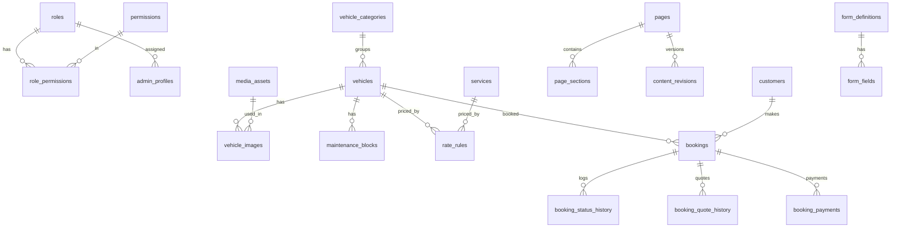

# Rent2Go — Backend Schema

**DB:** PostgreSQL (Supabase) | **Version:** 1.0 | **Related:** `02_TRD_Rent2Go.md`

> Ye schema *starting point* hai. Production se pehle constraints, indexes, RLS aur migrations review + test karein. Naming snake_case; timestamps `timestamptz` (UTC store, Asia/Karachi display).

---

## 1. Conventions

- Primary keys: `uuid` (`gen_random_uuid()`).
- Translatable text: `jsonb` → `{"en": "...", "ur": "..."}`.
- Money: `numeric(12,2)`, currency default `PKR`.
- Soft delete: `deleted_at timestamptz` (jahan zaroori).
- Har table: `created_at`, `updated_at` (trigger se auto-update).
- Public site **sirf published** data padhta hai (views/policies).
- Public booking/enquiry writes **server-side (service role)** se hon — anon ko direct insert policy nahi.

---

## 2. Entity Overview



---

## 3. Setup, Extensions & Enums

```sql
create extension if not exists "pgcrypto";
create extension if not exists "btree_gist";   -- exclusion constraints
create extension if not exists "pg_trgm";      -- search

create type vehicle_visibility   as enum ('draft','published','hidden');
create type vehicle_op_status    as enum ('available','temporarily_unavailable','maintenance');
create type booking_status       as enum ('pending','need_more_info','confirmed','rejected','cancelled','completed','no_show');
create type booking_source       as enum ('website','whatsapp','phone','referral','walk_in','other');
create type contact_method       as enum ('call','whatsapp','email');
create type rental_type          as enum ('daily','hourly','one_way','round_trip','weekly','monthly','wedding_event','custom');
create type price_unit           as enum ('per_hour','per_day','per_week','per_month','per_trip','per_km');
create type payment_status       as enum ('unpaid','deposit_requested','deposit_received','partially_paid','paid','refunded','issue');
create type review_status        as enum ('pending','approved','hidden','rejected');
create type content_status       as enum ('draft','scheduled','published','archived');
create type notif_channel        as enum ('in_app','email','whatsapp','sms');
create type notif_status         as enum ('queued','sent','failed','skipped');
create type enquiry_status       as enum ('new','in_progress','converted','closed');

-- updated_at trigger
create or replace function set_updated_at() returns trigger as $$
begin new.updated_at = now(); return new; end; $$ language plpgsql;
```

---

## 4. Auth, Roles & Permissions

```sql
create table roles (
  id uuid primary key default gen_random_uuid(),
  key text unique not null,               -- owner, admin, manager, staff, content_editor, viewer, custom_x
  name text not null,
  is_system boolean not null default false,
  created_at timestamptz default now()
);

create table permissions (
  id uuid primary key default gen_random_uuid(),
  key text unique not null,               -- e.g. 'bookings.confirm'
  module text not null,                   -- bookings, cars, content, theme, settings...
  action text not null,                   -- view, create, edit, delete, publish, export, confirm...
  description text
);

create table role_permissions (
  role_id uuid references roles(id) on delete cascade,
  permission_id uuid references permissions(id) on delete cascade,
  primary key (role_id, permission_id)
);

create table admin_profiles (
  user_id uuid primary key references auth.users(id) on delete cascade,
  full_name text not null,
  role_id uuid not null references roles(id),
  is_active boolean not null default true,
  last_login_at timestamptz,
  created_at timestamptz default now(),
  updated_at timestamptz default now()
);

-- Permission check (used by RLS + server)
create or replace function has_permission(p_key text) returns boolean
language sql stable security definer set search_path = public as $$
  select exists (
    select 1
    from admin_profiles ap
    join role_permissions rp on rp.role_id = ap.role_id
    join permissions p on p.id = rp.permission_id
    where ap.user_id = auth.uid() and ap.is_active and p.key = p_key
  );
$$;
```

**Permission keys (seed):**
`dashboard.view` · `bookings.view/create/edit/confirm/reject/cancel/complete/export` · `calendar.view/edit` · `cars.view/create/edit/delete/publish` · `customers.view/edit/export` · `pricing.view/edit` · `services.view/edit` · `content.view/edit/publish/rollback` · `media.view/upload/delete` · `navigation.edit` · `theme.edit` · `translations.edit` · `seo.edit` · `forms.edit` · `reviews.moderate` · `reports.view/export` · `team.view/manage` · `settings.view/edit` · `audit.view`

---

## 5. Site Configuration (CMS Foundation)

```sql
-- Key-value business + site settings
create table site_settings (
  key text primary key,                    -- business_name, phone, whatsapp, email, address, map_lat, map_lng,
                                           -- business_hours, holidays, default_locale, timezone, currency,
                                           -- booking_rules, whatsapp_template, analytics, maintenance_mode ...
  value jsonb not null,
  is_public boolean not null default false, -- public site padh sakti hai?
  updated_by uuid references auth.users(id),
  updated_at timestamptz default now()
);

create table theme_settings (
  id uuid primary key default gen_random_uuid(),
  status content_status not null default 'draft',   -- draft / published
  tokens jsonb not null,                    -- {colors:{primary,accent,...}, fonts:{...}, radius:8, button_style:'solid'}
  logo_media_id uuid,
  favicon_media_id uuid,
  published_at timestamptz,
  updated_by uuid references auth.users(id),
  updated_at timestamptz default now()
);

create table feature_flags (
  key text primary key,                     -- self_drive, hourly_rental, airport_transfer, reviews, floating_whatsapp,
                                            -- announcement_bar, payments_tracking, booking_status_lookup
  enabled boolean not null default false,
  config jsonb not null default '{}',
  updated_by uuid references auth.users(id),
  updated_at timestamptz default now()
);

create table translations (
  id uuid primary key default gen_random_uuid(),
  namespace text not null default 'common',
  key text not null,                        -- 'nav.cars', 'booking.errors.pickup_future'
  locale text not null check (locale in ('en','ur')),
  value text not null,
  updated_by uuid references auth.users(id),
  updated_at timestamptz default now(),
  unique (namespace, key, locale)
);

create table navigation_items (
  id uuid primary key default gen_random_uuid(),
  menu text not null check (menu in ('header','footer_main','footer_legal')),
  parent_id uuid references navigation_items(id) on delete cascade,
  label jsonb not null,                     -- {en, ur}
  link_type text not null check (link_type in ('page','url','route')),
  page_id uuid,                             -- if link_type='page'
  url text,
  open_in_new_tab boolean default false,
  sort_order int not null default 0,
  is_visible boolean not null default true,
  updated_at timestamptz default now()
);

create table redirects (
  id uuid primary key default gen_random_uuid(),
  from_path text unique not null,
  to_path text not null,
  status_code int not null default 301 check (status_code in (301,302)),
  is_active boolean not null default true,
  created_at timestamptz default now()
);
```

### 5.1 Media Library
```sql
create table media_folders (
  id uuid primary key default gen_random_uuid(),
  name text not null,
  parent_id uuid references media_folders(id) on delete cascade
);

create table media_assets (
  id uuid primary key default gen_random_uuid(),
  folder_id uuid references media_folders(id) on delete set null,
  storage_path text not null unique,
  mime_type text not null,
  file_size int not null,
  width int, height int,
  alt_text jsonb default '{}',              -- {en, ur}
  title text,
  uploaded_by uuid references auth.users(id),
  created_at timestamptz default now(),
  deleted_at timestamptz
);
create index on media_assets (folder_id);
create index on media_assets using gin (title gin_trgm_ops);
```

### 5.2 Pages, Sections, Revisions (Advanced CMS)
```sql
create table pages (
  id uuid primary key default gen_random_uuid(),
  slug text not null unique,                -- 'home','about','faq','terms','privacy','custom-page'
  page_type text not null default 'custom' check (page_type in ('system','custom','legal')),
  title jsonb not null,                     -- {en, ur}
  seo jsonb not null default '{}',          -- {title:{en,ur}, description:{en,ur}, og_media_id, canonical, noindex}
  status content_status not null default 'draft',
  publish_at timestamptz,                   -- scheduled publish
  published_revision_id uuid,
  is_deletable boolean not null default true,  -- system pages delete nahi hon
  created_by uuid references auth.users(id),
  created_at timestamptz default now(),
  updated_at timestamptz default now()
);

-- Working (draft) sections
create table page_sections (
  id uuid primary key default gen_random_uuid(),
  page_id uuid not null references pages(id) on delete cascade,
  block_type text not null,                 -- hero, rich_text, image_text, card_grid, faq, featured_cars, cta, gallery...
  variant text default 'default',
  props jsonb not null default '{}',        -- block-specific, translatable values {en,ur}; validated by Zod
  sort_order int not null default 0,
  is_visible boolean not null default true,
  updated_at timestamptz default now()
);
create index on page_sections (page_id, sort_order);

-- Immutable snapshots (published history + rollback)
create table content_revisions (
  id uuid primary key default gen_random_uuid(),
  page_id uuid not null references pages(id) on delete cascade,
  version int not null,
  snapshot jsonb not null,                  -- {page meta, seo, sections[]}
  note text,
  created_by uuid references auth.users(id),
  created_at timestamptz default now(),
  unique (page_id, version)
);

alter table pages add constraint fk_pages_published_rev
  foreign key (published_revision_id) references content_revisions(id);
```
**Flow:** edit → `page_sections` (draft) → Publish → snapshot `content_revisions` → `pages.published_revision_id` set → public reads snapshot → rollback = naya revision (purane snapshot se) publish.

### 5.3 FAQs, Offers, Announcements
```sql
create table faq_categories (
  id uuid primary key default gen_random_uuid(),
  name jsonb not null, sort_order int default 0
);
create table faqs (
  id uuid primary key default gen_random_uuid(),
  category_id uuid references faq_categories(id) on delete set null,
  question jsonb not null, answer jsonb not null,   -- {en, ur}
  sort_order int default 0,
  is_visible boolean default true,
  show_on_home boolean default false,
  updated_at timestamptz default now()
);
create table offers (
  id uuid primary key default gen_random_uuid(),
  kind text not null check (kind in ('offer','announcement')),
  title jsonb not null, body jsonb, link_url text,
  starts_at timestamptz, ends_at timestamptz,
  is_enabled boolean default true,
  placement text default 'top_bar',           -- top_bar, home_banner, popup
  created_at timestamptz default now()
);
```

### 5.4 Form Builder
```sql
create table form_definitions (
  id uuid primary key default gen_random_uuid(),
  key text unique not null,                  -- 'booking_request','contact_enquiry'
  title jsonb, is_active boolean default true
);
create table form_fields (
  id uuid primary key default gen_random_uuid(),
  form_id uuid not null references form_definitions(id) on delete cascade,
  field_key text not null,                   -- 'full_name','phone','pickup_location','flight_number',...
  field_type text not null,                  -- text, phone, date, datetime, select, textarea, checkbox, number
  label jsonb not null, placeholder jsonb, help_text jsonb,
  options jsonb,                             -- for select
  is_required boolean default false,
  is_visible boolean default true,
  is_core boolean default false,             -- core fields hide/remove nahi hon
  show_when jsonb,                           -- conditional rule e.g. {"service":"airport_transfer"}
  sort_order int default 0,
  unique (form_id, field_key)
);
```

---

## 6. Vehicles & Catalogue

```sql
create table vehicle_categories (
  id uuid primary key default gen_random_uuid(),
  slug text unique not null,
  name jsonb not null,                       -- Hatchback, Sedan, SUV, Van, Luxury...
  sort_order int default 0, is_active boolean default true
);

-- Admin-defined extra spec fields
create table vehicle_field_definitions (
  id uuid primary key default gen_random_uuid(),
  field_key text unique not null,            -- 'luggage_capacity','mileage'
  label jsonb not null,
  field_type text not null check (field_type in ('text','number','boolean','select','list')),
  options jsonb,
  show_on_card boolean default false,
  sort_order int default 0,
  is_active boolean default true
);

create table vehicles (
  id uuid primary key default gen_random_uuid(),
  stock_code text unique,                    -- internal ID (public par expose nahi)
  slug text unique not null,
  category_id uuid references vehicle_categories(id),
  make text not null, model text not null, variant text, model_year int
    check (model_year between 1980 and 2100),
  title jsonb,                               -- optional override
  description jsonb,                         -- {en, ur}
  seats int check (seats between 1 and 60),
  doors int, transmission text check (transmission in ('automatic','manual','other')),
  fuel_type text, has_ac boolean,
  luggage_note jsonb,
  driver_option text not null default 'with_driver'
    check (driver_option in ('with_driver','self_drive','both')),
  features jsonb default '[]',               -- verified features list
  custom_fields jsonb default '{}',          -- {field_key: value}
  visibility vehicle_visibility not null default 'draft',
  op_status vehicle_op_status not null default 'available',
  is_featured boolean default false,
  featured_order int,
  cover_media_id uuid references media_assets(id),
  video_url text,
  internal_notes text,
  seo jsonb default '{}',
  created_by uuid references auth.users(id),
  created_at timestamptz default now(),
  updated_at timestamptz default now(),
  deleted_at timestamptz
);
create index on vehicles (visibility, op_status) where deleted_at is null;
create index on vehicles (category_id);
create index on vehicles (is_featured, featured_order);

create table vehicle_images (
  id uuid primary key default gen_random_uuid(),
  vehicle_id uuid not null references vehicles(id) on delete cascade,
  media_id uuid not null references media_assets(id),
  alt_text jsonb default '{}',
  sort_order int default 0,
  is_cover boolean default false
);
create index on vehicle_images (vehicle_id, sort_order);

create table services (
  id uuid primary key default gen_random_uuid(),
  slug text unique not null,
  service_key text,                          -- with_driver, self_drive, airport_transfer, wedding, corporate...
  name jsonb not null, short_desc jsonb, description jsonb,
  inclusions jsonb, exclusions jsonb, terms jsonb, how_pricing_works jsonb,
  icon text, cover_media_id uuid references media_assets(id),
  is_enabled boolean default false,
  sort_order int default 0,
  seo jsonb default '{}',
  updated_at timestamptz default now()
);

create table vehicle_services (
  vehicle_id uuid references vehicles(id) on delete cascade,
  service_id uuid references services(id) on delete cascade,
  primary key (vehicle_id, service_id)
);

create table service_areas (
  id uuid primary key default gen_random_uuid(),
  name jsonb not null,
  area_type text check (area_type in ('pickup_zone','delivery_zone','destination','route')),
  details jsonb, is_active boolean default true, sort_order int default 0
);
```

---

## 7. Pricing

```sql
create table rate_rules (
  id uuid primary key default gen_random_uuid(),
  name text not null,
  vehicle_id uuid references vehicles(id) on delete cascade,     -- null = all
  service_id uuid references services(id) on delete cascade,
  service_area_id uuid references service_areas(id),
  rental_type rental_type,
  unit price_unit not null,
  base_amount numeric(12,2) check (base_amount >= 0),           -- NULL = contact for quote
  min_duration_hours int,
  driver_fee numeric(12,2),
  fuel_included boolean, driver_included boolean,
  toll_included boolean, parking_included boolean,
  delivery_fee numeric(12,2),
  overtime_per_hour numeric(12,2),
  extra_km_rate numeric(12,2), included_km int,
  security_deposit numeric(12,2),
  inclusion_notes jsonb, exclusion_notes jsonb,
  priority int default 0,
  effective_from date not null default current_date,
  effective_to date,
  is_active boolean default true,
  created_by uuid references auth.users(id),
  created_at timestamptz default now(),
  check (effective_to is null or effective_to >= effective_from)
);
create index on rate_rules (vehicle_id, is_active, effective_from);

create table rate_rule_history (
  id uuid primary key default gen_random_uuid(),
  rate_rule_id uuid not null,
  before jsonb, after jsonb,
  changed_by uuid, changed_at timestamptz default now()
);
```

---

## 8. Customers, Enquiries & Bookings

```sql
create table customers (
  id uuid primary key default gen_random_uuid(),
  full_name text not null,
  phone_e164 text not null,                  -- +923XXXXXXXXX normalized
  email text,
  preferred_contact contact_method default 'whatsapp',
  company_name text,
  tags text[] default '{}',
  internal_notes text,
  follow_up_at timestamptz,
  created_at timestamptz default now(),
  updated_at timestamptz default now(),
  deleted_at timestamptz,
  unique (phone_e164)
);

create table enquiries (
  id uuid primary key default gen_random_uuid(),
  customer_id uuid references customers(id),
  name text, phone_e164 text, email text,
  message text not null check (char_length(message) <= 2000),
  service_id uuid references services(id),
  source booking_source default 'website',
  status enquiry_status default 'new',
  follow_up_at timestamptz, internal_notes text,
  assigned_to uuid references auth.users(id),
  created_at timestamptz default now()
);
create index on enquiries (status, created_at desc);

create table bookings (
  id uuid primary key default gen_random_uuid(),
  reference text not null unique,            -- R2G-XXXXXXXX (crypto random)
  customer_id uuid not null references customers(id),
  vehicle_id uuid references vehicles(id),   -- null for custom/service-only enquiry
  service_id uuid references services(id),
  status booking_status not null default 'pending',
  source booking_source not null default 'website',
  rental_type rental_type not null,
  driver_option text,
  pickup_at timestamptz not null,
  return_at timestamptz,
  pickup_location text not null,
  dropoff_location text,
  destination text not null,
  passengers int check (passengers > 0),
  extra_details jsonb default '{}',          -- flight_number, company, form-builder extras
  customer_notes text check (char_length(customer_notes) <= 1000),
  internal_notes text,
  estimate jsonb,                            -- server-calculated estimate snapshot
  confirmed_quote jsonb,                     -- frozen agreed quote
  confirmed_total numeric(12,2),
  deposit_amount numeric(12,2),
  payment_status payment_status default 'unpaid',
  assigned_to uuid references auth.users(id),
  idempotency_key text unique,
  consent_accepted_at timestamptz not null,
  consent_version text,
  cancel_reason text,
  during tstzrange generated always as (tstzrange(pickup_at, return_at, '[)')) stored,
  created_at timestamptz default now(),
  updated_at timestamptz default now(),
  check (return_at is null or return_at > pickup_at)
);

-- HARD double-booking guard (confirmed only)
alter table bookings add constraint no_overlap_confirmed
  exclude using gist (vehicle_id with =, during with &&)
  where (status = 'confirmed' and vehicle_id is not null and return_at is not null);

create index on bookings (status, pickup_at);
create index on bookings (customer_id);
create index on bookings (vehicle_id, pickup_at);
create index on bookings using gist (vehicle_id, during);

create table booking_status_history (
  id uuid primary key default gen_random_uuid(),
  booking_id uuid not null references bookings(id) on delete cascade,
  from_status booking_status, to_status booking_status not null,
  reason text, changed_by uuid references auth.users(id),   -- null = customer/system
  changed_at timestamptz default now()
);
create index on booking_status_history (booking_id, changed_at);

create table booking_quote_history (
  id uuid primary key default gen_random_uuid(),
  booking_id uuid not null references bookings(id) on delete cascade,
  quote jsonb not null, total numeric(12,2),
  kind text check (kind in ('estimate','final','revised')),
  created_by uuid references auth.users(id), created_at timestamptz default now()
);

create table booking_payments (
  id uuid primary key default gen_random_uuid(),
  booking_id uuid not null references bookings(id) on delete cascade,
  amount numeric(12,2) not null check (amount >= 0),
  currency text default 'PKR',
  method text,                               -- cash / bank_transfer / wallet / other (label only)
  kind text check (kind in ('deposit','payment','refund')),
  receipt_note text,
  paid_at timestamptz default now(),
  recorded_by uuid references auth.users(id)
);
-- NOTE: card numbers / PIN / OTP / bank passwords KABHI store na karein.

create table maintenance_blocks (
  id uuid primary key default gen_random_uuid(),
  vehicle_id uuid not null references vehicles(id) on delete cascade,
  starts_at timestamptz not null, ends_at timestamptz not null,
  reason text, created_by uuid references auth.users(id),
  during tstzrange generated always as (tstzrange(starts_at, ends_at, '[)')) stored,
  check (ends_at > starts_at),
  exclude using gist (vehicle_id with =, during with &&)
);

-- Cross-table conflict: confirmed booking vs maintenance (and vice versa)
create or replace function check_booking_vs_maintenance() returns trigger as $$
begin
  if new.status = 'confirmed' and new.vehicle_id is not null and new.return_at is not null then
    if exists (
      select 1 from maintenance_blocks m
      where m.vehicle_id = new.vehicle_id and m.during && new.during
    ) then
      raise exception 'VEHICLE_IN_MAINTENANCE' using errcode = '23P01';
    end if;
  end if;
  return new;
end; $$ language plpgsql;

create trigger trg_booking_maintenance
before insert or update on bookings
for each row execute function check_booking_vs_maintenance();

-- Availability helper (buffer minutes setting server side add karein)
create or replace function is_vehicle_available(p_vehicle uuid, p_start timestamptz, p_end timestamptz, p_buffer_min int default 0)
returns boolean language sql stable as $$
  select not exists (
    select 1 from bookings b
    where b.vehicle_id = p_vehicle and b.status = 'confirmed'
      and b.during && tstzrange(p_start - make_interval(mins => p_buffer_min),
                                p_end   + make_interval(mins => p_buffer_min), '[)')
  ) and not exists (
    select 1 from maintenance_blocks m
    where m.vehicle_id = p_vehicle
      and m.during && tstzrange(p_start, p_end, '[)')
  ) and exists (
    select 1 from vehicles v
    where v.id = p_vehicle and v.visibility = 'published'
      and v.op_status = 'available' and v.deleted_at is null
  );
$$;
```

---

## 9. Reviews, Notifications, Audit, Misc

```sql
create table reviews (
  id uuid primary key default gen_random_uuid(),
  display_name text not null,
  rating int not null check (rating between 1 and 5),
  body text not null,
  trip_date date,
  vehicle_id uuid references vehicles(id),
  source text,                               -- verified source note (google / customer / etc.)
  status review_status not null default 'pending',
  admin_reply text,
  moderated_by uuid references auth.users(id), moderated_at timestamptz,
  created_at timestamptz default now()
);
create index on reviews (status, created_at desc);

create table admin_notifications (
  id uuid primary key default gen_random_uuid(),
  type text not null,                        -- new_booking, booking_updated, conflict, channel_failure
  title text not null, body text, link text,
  is_read boolean default false,
  created_at timestamptz default now()
);

create table notification_templates (
  key text primary key,                      -- booking_received, booking_confirmed...
  channel notif_channel not null,
  subject jsonb, body jsonb,                 -- {en, ur}
  is_enabled boolean default true
);

create table notification_log (
  id uuid primary key default gen_random_uuid(),
  event text not null, channel notif_channel not null,
  recipient_hint text,                       -- masked (e.g. +92•••••1234)
  booking_id uuid references bookings(id) on delete set null,
  status notif_status not null default 'queued',
  attempts int default 0, error text,
  created_at timestamptz default now(), sent_at timestamptz
);

create table audit_events (
  id uuid primary key default gen_random_uuid(),
  actor_id uuid references auth.users(id),
  actor_role text,
  module text not null, action text not null,
  entity_type text, entity_id text,
  before jsonb, after jsonb,                 -- sensitive fields redact
  ip inet, user_agent text,
  created_at timestamptz default now()
);
create index on audit_events (module, created_at desc);
create index on audit_events (actor_id, created_at desc);

create table idempotency_keys (
  key text primary key,
  response jsonb, created_at timestamptz default now()
);

create table security_events (
  id uuid primary key default gen_random_uuid(),
  event text not null,                       -- login_failed, lockout, permission_denied
  user_id uuid, ip inet, meta jsonb,
  created_at timestamptz default now()
);

create table analytics_events (              -- optional, NO PII
  id bigserial primary key,
  event text not null, entity_type text, entity_id uuid,
  source text, created_at timestamptz default now()
);
```

---

## 10. Row Level Security (RLS) — Policy Plan

```sql
-- Sab tables par RLS ON
alter table vehicles enable row level security;
alter table bookings enable row level security;
alter table customers enable row level security;
-- ... (har table par)

-- PUBLIC: sirf published/active content
create policy "public read published vehicles" on vehicles
  for select to anon, authenticated
  using (visibility = 'published' and deleted_at is null);

create policy "public read enabled services" on services
  for select to anon, authenticated using (is_enabled = true);

create policy "public read approved reviews" on reviews
  for select to anon, authenticated using (status = 'approved');

create policy "public read public settings" on site_settings
  for select to anon, authenticated using (is_public = true);

-- ADMIN: permission based
create policy "admin view vehicles" on vehicles
  for select to authenticated using (has_permission('cars.view'));
create policy "admin edit vehicles" on vehicles
  for update to authenticated using (has_permission('cars.edit')) with check (has_permission('cars.edit'));
create policy "admin create vehicles" on vehicles
  for insert to authenticated with check (has_permission('cars.create'));

create policy "staff view bookings" on bookings
  for select to authenticated using (has_permission('bookings.view'));
create policy "staff edit bookings" on bookings
  for update to authenticated using (has_permission('bookings.edit'));

create policy "view customers" on customers
  for select to authenticated using (has_permission('customers.view'));

create policy "audit read" on audit_events
  for select to authenticated using (has_permission('audit.view'));
-- audit_events: insert server-side only; update/delete policy NAHI (app level immutable; true immutability DB-level guarantee ke baghair claim na karein)
```

**Rules**
- `anon` ko bookings/customers/enquiries/audit par **koi** direct access nahi (public booking server route se, service role).
- Service-role key kabhi client bundle mein nahi.
- Public pages/CMS ke liye `published_revision_id` snapshot hi serve hota hai.
- **RLS test suite:** anon denied, staff limited, content_editor ko bookings/customers denied, viewer write denied.

---

## 11. Seed Data (Initial)
- `roles` + `permissions` + `role_permissions` (default role matrix).
- `form_definitions` + core `form_fields` (booking_request, contact_enquiry).
- `feature_flags`: sab **false** (self_drive, hourly, airport, etc.) — owner enable kare.
- `services`: 10 entries `is_enabled = false`.
- `pages`: home, about, faq, terms, privacy, cancellation-policy, contact (system pages, `is_deletable=false`, draft).
- `translations`: base UI strings EN/UR.
- `site_settings`: **empty/null values** (phone, whatsapp, hours, address) — koi sample active nahi.
- Owner account (manual invite).

---

## 12. Index & Performance Notes
| Query | Index |
|---|---|
| Cars list (published, status) | `vehicles(visibility, op_status)` partial |
| Car by slug | unique `vehicles(slug)` |
| Booking by reference | unique `bookings(reference)` |
| Bookings by status/date | `bookings(status, pickup_at)` |
| Availability | GiST `bookings(vehicle_id, during)` |
| Customer by phone | unique `customers(phone_e164)` |
| Enquiry inbox | `enquiries(status, created_at desc)` |
| Admin media search | trigram on `media_assets(title)` |
| Audit | `(module, created_at desc)` |

---

## 13. Data Retention & Backup
- Old enquiries/bookings: retention period owner/legal se decide; scheduled anonymize/archive job.
- Daily automated DB backup + storage backup; **restore drill** launch se pehle.
- Soft delete customers/vehicles; permanent purge sirf Owner.
- Logs mein PII masked.

---

## 14. Migration Plan (Files)
```
/supabase/migrations
  0001_extensions_enums.sql
  0002_auth_roles_permissions.sql
  0003_site_config_cms.sql
  0004_media.sql
  0005_vehicles_services.sql
  0006_pricing.sql
  0007_customers_bookings.sql
  0008_availability_constraints.sql
  0009_reviews_notifications_audit.sql
  0010_rls_policies.sql
  0011_seed.sql
```
Har migration: review → staging apply → RLS/constraint tests → production.
